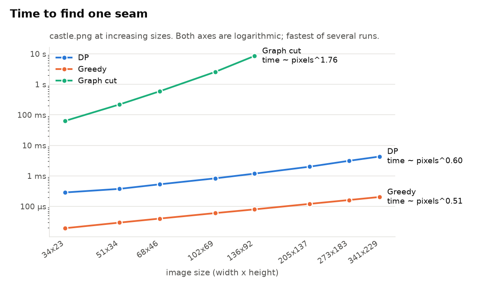
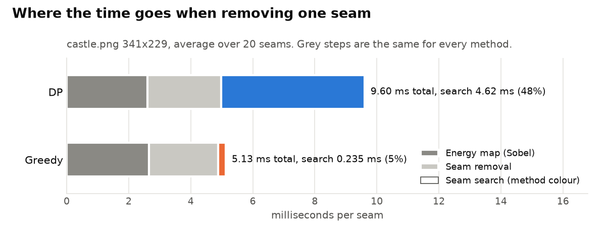

# Seam Carving - CSD3131 Assignment 2

Content-aware image resizing using seam carving (Avidan & Shamir, 2007). The project implements three seam-finding strategies behind a common interface and compares them on seam quality, visual quality and running time:

| Method | Approach | Status |
|---|---|---|
| Dynamic programming | Exact minimum-cost seam in O(H*W) | Implemented |
| Greedy | Row-by-row local minimum in O(H) | Implemented |
| Graph cut | Min s-t cut via max-flow (Edmonds-Karp) | Implemented |

## Requirements

- Python 3.10 or newer
- Dependencies listed in [`requirements.txt`](requirements.txt) (NumPy, OpenCV, pytest, Matplotlib for the timing charts)

## Installation

1. Clone the repository and create a virtual environment:

   ```bash
   git clone <repository-url>
   cd csd3131_A2
   python -m venv .venv
   ```

2. Activate it:

   | Shell | Command |
   |---|---|
   | Linux / WSL | `source .venv/bin/activate` |
   | Windows PowerShell | `.venv\Scripts\Activate.ps1` |
   | Windows Command Prompt | `.venv\Scripts\activate.bat` |

   If PowerShell reports that running scripts is disabled, run `Set-ExecutionPolicy -Scope CurrentUser RemoteSigned` once and retry.

3. Install the dependencies:

   ```bash
   pip install -r requirements.txt
   ```

## Usage

```bash
python -m seamcarving <input> <output> [--width W] [--height H] [--forward | --greedy | --graphcut]
```

`--forward` selects forward-energy DP (see [Forward energy](#forward-energy-improvement)), which reduces visual artifacts in textured regions but takes slightly longer. `--greedy` selects the greedy seam (see [Greedy vs DP](#greedy-algorithm-vs-dynamic-programming)), which is faster but finds much worse seams. `--graphcut` finds seams by min-cut/max-flow (see [Graph cut vs DP](#graph-cut-vs-dynamic-programming)): the same seams as DP, but thousands of times slower, so use it on small images only.

Test examples: 
```bash
python -m seamcarving castle.png out.png --width 250 --height 180
```
341x229 -> 250x180 in 0.96s
```bash
python -m seamcarving surfer.png out2.png --width 920 --height 880
```
1920x1079 -> 920x880 in 145.69s

```bash
python -m seamcarving castle.png out.png --width 250 --height 180 --forward
```
341x229 -> 250x180 in 1.04s
```bash
python -m seamcarving surfer.png out2.png --width 920 --height 880 --forward
```
1920x1079 -> 920x880 in 161.60s

```bash
python -m seamcarving castle.png out.png --width 250 --height 180 --greedy
```
341x229 -> 250x180 in 0.31s

Omitted dimensions are left unchanged. The current implementation only reduces image size.

## Interactive Web App

Resize an image with sliders and watch every seam being removed, one at a time. It needs no extra dependencies: the server is Python's built-in `http.server`, and all carving is done by the same DP code as the command line.

```bash
python -m seamcarving.webapp [image] [--forward] [--max-side 500] [--port 8000] [--no-browser]
```

The browser opens at http://localhost:8000. The image is optional; one can also be uploaded on the page. Images are first shrunk so the longer side is at most `--max-side` pixels, to keep the animation smooth. Press `Ctrl+C` in the terminal to stop.

| Control | What it does |
|---|---|
| Width / Height | Target size. The image follows one seam at a time, width first and then height. Dragging back up restores seams in reverse order. |
| Speed | Seams per animation frame (1 to 20). |
| Pause / Play, Step | Stop or continue the animation; Step removes or restores exactly one seam. |
| Reset | Back to the original image and full-size sliders. |
| Upload image | Start again with another image. |
| Save result | Download the carved image as `carved.png` (wait for the animation to finish, or the current seam is included). |
| Forward energy | Switch DP method and replay the same resize from the original. |

| Panel | Shows |
|---|---|
| Seam carving | The carved image. Red is the seam about to be removed, green a seam just put back. |
| Energy map | Energy of the carved image (bright = important) with the same seam. |
| Original with every removed seam | All seams removed so far: red = vertical, blue = horizontal. |
| Plain scaling | The original scaled to the same size, for comparison. |

How it works: the page (`webapp.html`) only has the controls and displays pictures. About 30 times a second it asks the server (`webapp.py`) to move a few seams closer to the slider size. The server owns one `CarveSession` (`interactive.py`), which carves an *index map* (which original pixel sits at each position) instead of the image itself. The current image, the set of all removed seams and undo all follow from that map.

## Project Structure

```
seamcarving/
- energy.py     Energy map (Sobel gradient magnitude)
- backward.py   Standard (backward-energy) DP: cumulative-cost table and minimum seam
- forward.py    Forward-energy DP variant (optional improvement)
- greedy.py     Greedy row-by-row seam (alternative to DP)
- graphcut.py   Min-cut / max-flow seam (Edmonds-Karp, alternative to DP)
- carve.py      Seam removal and the iterative resize loop
- __main__.py   Command-line interface
- compare.py    Greedy vs DP comparison: seams, visual quality, running time
- compare_graphcut.py  Graph cut vs DP comparison: seams, visual quality, running time
- benchmark.py  Running time of all three methods: charts and tables
- interactive.py  Step-by-step carving session with undo (used by the web app)
- webapp.py     Local web server for the interactive app
- webapp.html   The web page: sliders, buttons and the four panels
```

## How It Works

1. **Energy map.** Each pixel is scored by its Sobel gradient magnitude, `|dI/dx| + |dI/dy|`. Low energy means the pixel resembles its neighbours and is cheap to remove.
2. **Minimum seam.** A vertical seam is one pixel per row, with consecutive pixels in the same or adjacent columns. The cheapest seam is found with the recurrence

   ```
   M[0][j] = e[0][j]
   M[i][j] = e[i][j] + min(M[i-1][j-1], M[i-1][j], M[i-1][j+1])
   ```

   The seam ends at `argmin M[H-1]` and is recovered by following backpointers upward.
3. **Remove and repeat.** The seam is deleted and the energy map is recomputed, until the target size is reached. Horizontal seams are found by transposing the image.

### Forward energy (improvement)

The standard method above uses *backward* energy: it scores each pixel by how different it is from its neighbours before removal. It ignores the new adjacencies a removal creates, so seams can cut through textured regions and edges and join pixels that never touched. *Forward energy* (Rubinstein et al., 2008) instead charges each seam step for the intensity differences it creates:

```
cU = |I[i,j+1] - I[i,j-1]|                  seam moves straight down
cL = cU + |I[i-1,j] - I[i,j-1]|             seam came from up-left
cR = cU + |I[i-1,j] - I[i,j+1]|             seam came from up-right

M[0][j] = cU(0, j)
M[i][j] = min(M[i-1][j-1] + cL, M[i-1][j] + cU, M[i-1][j+1] + cR)
```

The DP structure and complexity are unchanged (O(H*W)). It needs the image rather than an energy map, so it is selected with `carve(..., forward=True)` or exposed directly as `find_vertical_seam_forward(img)`.

## Greedy Algorithm vs Dynamic Programming

The greedy seam (`greedy.py`) makes one local decision per row and never looks back:

```
seam[0] = argmin_j e[0][j]
seam[i] = argmin over j in {seam[i-1]-1, seam[i-1], seam[i-1]+1} of e[i][j]
```

It starts at the cheapest pixel of the top row and steps down to the cheapest of the (up to) three pixels below. The search is O(W + H) time and O(H) space per seam, against O(H*W) time and space for the DP table. It is not optimal: a cheap pixel now can lead the seam into a wall of high energy later, and since the decision is never revisited the seam has to cut through it. The DP avoids this because `M[i][j]` already includes the best way to reach every pixel.

Run the comparison with

```bash
python -m seamcarving.compare castle.png --width 250 --height 180
```

It writes images, a per-seam CSV and `summary.md` to `results/<image>/`. "Optimality gap" compares each greedy seam with the DP seam on the same image, so it isolates the greedy decision itself.

Results (backward energy, same machine):

| | castle 341x229 -> 250x180 (DP / Greedy) | surfer 1920x1079 -> 920x880 (DP / Greedy) |
|---|---|---|
| Whole carve | 0.64 s / 0.31 s (2.0x faster) | 134.1 s / 77.4 s (1.7x faster) |
| Seam search only | 0.34 s / 0.02 s (19x faster) | 57.6 s / 1.7 s (33x faster) |
| Total energy removed | 837,827 / 1,515,325 (1.81x) | 39.6M / 51.3M (1.30x) |
| Greedy seam vs optimal on the same image | median 3.21x, worst 12.61x | median 3.06x, worst 7.59x |
| Seams where greedy was optimal | 0 of 140 | 0 of 1199 |

- **Seams.** The first greedy and DP seams share no rows on either image. DP seams bend around objects to stay in low-energy sky or water. Greedy seams follow whatever is cheapest right below them, so they drift straight down and cut through the castle towers and across the surfers.
- **Visual quality.** Greedy is not comparable to DP. On castle the middle tower is visibly squeezed and the towers lose their shape; on surfer the left surfer is squashed and the board is distorted, while DP keeps both surfers intact.
- **Running time.** The greedy search itself is 19-33x faster (O(H) instead of O(H*W) per seam), but the whole carve is only about 2x faster, because both methods spend the same time recomputing the Sobel energy map and removing the seam after every step. Those steps, not the seam search, are what dominate the greedy run.

## Graph Cut vs Dynamic Programming

`graphcut.py` finds the seam as a minimum s-t cut. Each pixel is a node in a flow network:

| Edge | Capacity | Purpose |
|---|---|---|
| source -> `(i, 0)` | inf | The left column is always on the source side |
| `(i, j)` -> `(i, j+1)`, and `(i, W-1)` -> sink | `e[i][j]` | Cutting this edge removes pixel `(i, j)` |
| `(i, j+1)` -> `(i, j)` | inf | Each row is cut exactly once |
| `(i, j)` -> `(i-1, j-1)` and `(i+1, j-1)` | inf | Cuts in neighbouring rows are at most 1 column apart (a connected seam) |

A finite cut cannot cross an inf edge, so every finite cut is a vertical seam, and its capacity is the seam's total energy. Max-flow is computed with Edmonds-Karp (BFS shortest augmenting paths). The source side S is everything still reachable from the source in the residual graph, and the seam pixel in each row is the rightmost pixel of S. The last column is joined to the sink with capacity `e[i][W-1]` rather than inf, so seams can use the last column, as they can in DP. With that change the minimum cut equals the DP minimum exactly.

Run the comparison with

```bash
python -m seamcarving.compare_graphcut castle.png --scale 0.2 --width 52 --height 40
```

It shrinks the image first (`--scale`), because pure-Python max-flow takes minutes per seam at full size. It writes images, per-seam costs, a one-seam timing table at several sizes (`timing.csv`, `timing.png`) and `summary.md` to `results/<image>_graphcut/`.

Results (castle shrunk to 68x46 -> 52x40, 22 seams):

| | DP | Graph cut |
|---|---|---|
| Seam search, whole carve | 0.02 s | 20.4 s (about 900x slower) |
| Graph-cut seam vs optimal DP seam on the same image | | 1.000x on all 22 seams |

Time to find one seam:

| Image | Nodes | Edges | Augmenting paths | DP | Graph cut | Slower by |
|---|---|---|---|---|---|---|
| 34x23 | 784 | 3,016 | 213 | 0.36 ms | 0.11 s | 300x |
| 68x46 | 3,130 | 12,286 | 470 | 0.72 ms | 0.94 s | 1,300x |
| 136x92 | 12,514 | 49,594 | 1,067 | 1.8 ms | 10.2 s | 5,700x |
| 341x229 (full size) | 78,091 | 311,218 | not measured | 10 ms | ~400 s (one run, busy machine) | ~40,000x |

- **Seams.** Every graph-cut seam has exactly the DP cost, and the max-flow value equals the seam cost (max-flow min-cut theorem). The seams themselves can differ where two seams tie: the first seams share 44 of 46 rows.
- **Visual quality.** It is the same as DP. The carved images differ only where equal-cost seams broke ties differently.
- **Running time.** DP is O(HW). The graph has V = HW + 2 nodes and E ~ 4HW edges, and every augmenting path costs a full O(V + E) BFS. The number of paths also grows with the image, so the gap widens with size. DP uses the fact that a seam goes down row by row. Max-flow is a general algorithm and cannot use that.

## Running Time of All Three Methods

```bash
python -m seamcarving.benchmark castle.png
```

It writes two charts, their CSV files and `summary.md` to `results/benchmark/`. Graph cut is skipped on images above `--graphcut-max-pixels` (default 13,000), because one full-size seam takes minutes.



Time to find one seam on castle.png (fastest of several runs, one machine):

| Image | DP | Greedy | Graph cut |
|---|---|---|---|
| 34x23 | 286 us | 19 us | 63 ms (221x DP) |
| 136x92 | 1.18 ms | 80 us | 8.5 s (7,190x DP) |
| 341x229 | 4.3 ms | 203 us | not run |

- **Graph cut** grows like pixels^1.76, so its gap to DP widens with every size.
- **Greedy** grows like pixels^0.5: it only walks down H rows.
- **DP** is O(H*W), but measures pixels^0.6 on castle and pixels^0.8 on the 1920x1079 surfer image. Each row is one vectorised NumPy step, so on small images the fixed cost of the H row steps dominates; the per-pixel work only shows on large images.



Inside the carve loop, the energy map and the seam removal cost the same whichever method is used. On castle the DP search is 48% of each step and the greedy search 5%, which is why a 20x faster search makes the whole carve less than 2x faster.

## API Reference

All functions are importable from the `seamcarving` package. A *vertical seam* is an integer array of length `H`, where `seam[i]` is the column removed in row `i`.

| Function | Description |
|---|---|
| `compute_energy(img)` | Returns an `(H, W)` float64 energy map. |
| `find_vertical_seam(energy)` | Returns the minimum-cost vertical seam (DP). |
| `find_horizontal_seam(energy)` | Returns the minimum-cost horizontal seam; `seam[j]` is the row removed in column `j`. |
| `remove_vertical_seam(img, seam)` | Returns the image one pixel narrower. |
| `remove_horizontal_seam(img, seam)` | Returns the image one pixel shorter. |
| `seam_cost(energy, seam)` | Sum of energy along a seam. |
| `is_valid_seam(seam, H, W)` | Checks one pixel per row, in range, and connectivity. |
| `carve(img, new_w, new_h, seam_finder, on_seam, forward)` | Runs the full resize pipeline. `forward=True` uses forward-energy DP. |
| `find_vertical_seam_forward(img)` | Minimum forward-energy vertical seam; takes the image, not an energy map. |
| `forward_seam_cost(img, seam)` | Forward-energy cost of a seam (for comparisons and tests). |
| `find_vertical_seam_greedy(energy)` | Greedy row-by-row vertical seam (from `greedy.py`). |
| `find_horizontal_seam_greedy(energy)` | Greedy horizontal seam. |
| `find_vertical_seam_graphcut(energy)` | Minimum-cost vertical seam by min-cut/max-flow (from `graphcut.py`). |
| `find_horizontal_seam_graphcut(energy)` | Graph-cut horizontal seam. |

### Adding a seam-finding method

A seam finder is any function with the signature `energy (H, W) -> seam (int array, length H)`. Pass it to `carve`; horizontal seams are handled automatically by transposition.

```python
from seamcarving import carve

result = carve(img, 300, 200, seam_finder=my_find_vertical_seam)
```

### Step-by-step visualisation

`carve` accepts an optional `on_seam(kind, seam, img_before)` callback, invoked before each removal. `kind` is `"vertical"` or `"horizontal"`, and `seam` is expressed in the coordinates of `img_before`.

### Comparing methods

Different methods may return different seams of equal cost, since ties are broken differently (DP prefers the leftmost). When testing equivalence, compare `seam_cost` values rather than seam arrays.

## Testing

```bash
pytest
```

321 tests. DP, forward DP and graph cut are checked against a brute-force search over every possible seam on small images; see [`report/testing_section.md`](report/testing_section.md) for what each test file proves.

### Continuous integration

[`.github/workflows/tests.yml`](.github/workflows/tests.yml) runs the tests on every push and pull request, on Linux and Windows with Python 3.10 and 3.13. If they pass, a second job runs the benchmark and attaches the charts to the run as a downloadable artifact.

## References

- Avidan & Shamir, [*Seam Carving for Content-Aware Image Resizing*](https://dl.acm.org/doi/10.1145/1275808.1276390), SIGGRAPH 2007
- Rubinstein, Shamir & Avidan, [*Improved Seam Carving for Video Retargeting*](https://dl.acm.org/doi/pdf/10.1145/1360612.1360615), SIGGRAPH 2008
- [Seam carving - Wikipedia](https://en.wikipedia.org/wiki/Seam_carving)
- [*Seam Carving | Week 2, lecture 7 | 18.S191 MIT Fall 2020*](https://www.youtube.com/watch?v=rpB6zQNsbQU)

## AI Usage Declaration

Model used: Claude Opus 5.5 and Claude Sonnet 5.5 both on High effort

usage: 
- Helped to plot the graph for comparison between DP and Greedy 
- Checking through of code for bugs 

## Team

Group A2 - CSD3131 Assignment 2. Team members and SIT IDs to be added.